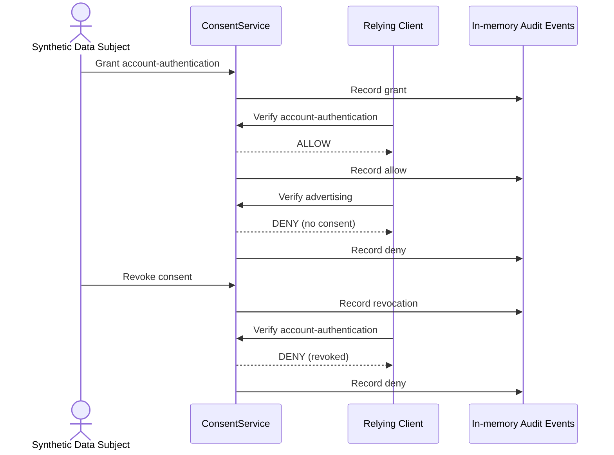

# MVP 1 — Executable Consent Lifecycle

**Status:** Implemented locally as a Python library and CLI demo; cloud deployment, database, and API authentication are **not yet implemented**.

## Problem and scope

A relying application must not process a simulated biometric operation unless the data subject has actively granted consent for **that exact purpose**, and consent remains active. The decision is made by deterministic rules, not an LLM. The demonstration uses only synthetic identifiers and no images or biometric templates.

The first milestone consists of:

- explicit `grant` by a synthetic data-subject principal;
- `verify` for a registered relying client and a specifically permitted purpose;
- `revoke` by the same data subject, immediately invalidating future verifications;
- a sequence of audit events for grants, denials, verification, revocation, and attempted privileged access;
- role restrictions preventing an administrator from granting/revoking subject consent or reading another subject's record; and
- focused `pytest` tests and a command-line demonstration.

## Code layout

```text
src/biometric_consent/
    __init__.py
    consent.py     # consent records, roles, decisions, in-memory service, audit events
    demo.py        # synthetic end-to-end CLI example
tests/
    test_repository_structure.py
    test_consent.py
```

## Run the demo

Using **Git Bash in VS Code**, from the repository root:

```bash
cd ~/work/AnieWall
source .venv/Scripts/activate   # only if your existing Windows virtual environment is present
python -m pip install -e '.[dev]'
python -m pytest -q
python -m biometric_consent.demo
```

Expected demo output includes:

```text
Approved purpose before revocation: ALLOW (active-purpose-matched)
Different purpose: DENY (no-consent)
Approved purpose after revocation: DENY (revoked)
Recorded audit events: 6
```

Exact identifiers and timestamps vary from run to run. The demo should be recorded as terminal screenshots for course evidence; no video is needed for this component.

## Data model and trust boundaries

| Component | What is currently implemented | Production requirement |
|---|---|---|
| `ConsentRecord` | Synthetic subject, exact purpose, UTC creation/revocation timestamp and unique consent ID | Transactional PostgreSQL storage, migrations, retention and encryption at rest |
| `Principal` | Caller-supplied test identity and role | **A trusted authentication boundary must construct identities from verified sessions/tokens. Never accept `role` or `subject_id` directly from untrusted JSON.** |
| `ConsentService` | Role, client-purpose and consent-state checks under an in-process lock | Authenticated FastAPI routes, per-tenant policy, transaction locks, expiry and replay controls |
| `AuditEvent` | Frozen event record, sequential number, read-only tuple snapshot for auditor | Append-only durable storage, restricted write access, monitored tamper-evidence, defined retention |
| Revoke | Idempotent and effective immediately inside the active process | Durable revocation and consistent enforcement by all replicas / caches |
| LLM | **No LLM permission to grant or override decisions** | Optional separately isolated consent-language **suggestion** service with human confirmation and validation |

### Authorization invariants

1. **No consent → DENY.**
2. **Wrong purpose → DENY.**
3. **Revoked consent → DENY.**
4. **Unregistered or unapproved relying client → DENY.**
5. Only an authenticated subject may grant/revoke their own consent; an administrator cannot override the policy.
6. Only a designated auditor role can retrieve the audit-event snapshot. Auditing a denial must not inadvertently disclose a consent ID to an unauthorized client.
7. Every state-changing or verification action is recorded with an outcome and reason. Audit data is separate from biometric images; **no biometric images are used**.

## Demo sequence



## Security limitations to disclose explicitly

This **is not a production biometric-consent system**. In particular, it has no verified authentication, real API, persistent storage, encrypted database, immutable off-process audit log, backup/restore plan, KMS, cloud networking, or deployment. A caller who can construct their own `Principal` can impersonate another user if the library is mistakenly exposed directly to untrusted network requests. That must be resolved before an HTTP API is exposed. In-memory state and audit records disappear on restart. The current code cannot guarantee GDPR/BIPA/Ghana Data Protection Act compliance by itself.

## Next milestones

1. **MVP 2:** FastAPI with a trusted identity/session boundary, strict schemas, separate public/client/auditor endpoints, and authenticated integration tests.
2. **MVP 3:** PostgreSQL consent and audit schemas, transactional revocation, migrations, retention controls, and backup/recovery tests.
3. **MVP 4:** Containerization and network-security demonstration on **one non-local cloud** (Chameleon preferred, subject to actual account/lease access), using `cmx vm` for infrastructure management; unit and regression tests stay local.
4. **MVP 5:** Optional Jetstream-hosted LLM language-to-purpose suggestion with strict allowlists, human confirmation, and no authorization override; optionally use a mock LLM service for deterministic tests, following Professor Gregor's `cloudmesh-ai-llm-mock` example.
5. **MVP 6:** Presentation material with an architecture diagram, deployed services, test evidence, failure scenarios, and explicit security limitations.

See also [Cloud security responsibilities and threat model](cloud-security-shared-responsibility.md).
