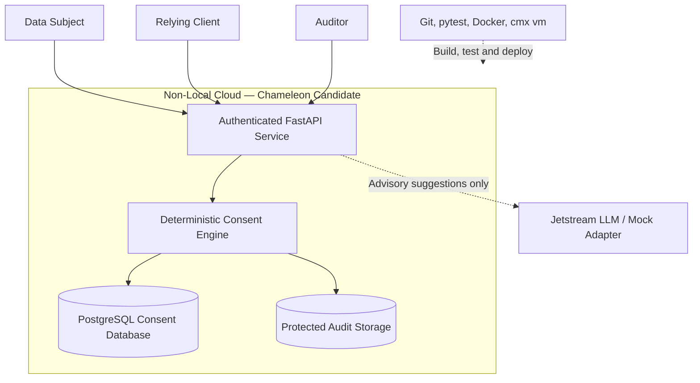

# Cloud-Native Biometric Consent and Audit Platform

**A Secure, Auditable, Cloud-Based Consent Management System**

| Project Information | Details |
|---|---|
| **Student** | Stephanie Wallace |
| **Course** | CS 388/488 — Cloud Computing, DevOps, and AI |
| **Instructor** | Professor Gregor von Laszewski |
| **GitHub Repository** | [cloudmesh-ai-luc/AnieWall](https://github.com/cloudmesh-ai-luc/AnieWall) |
| **Original Proposal** | October 15, 2026 |
| **Last Revised** | November 18, 2026 |
| **Development Status** | MVP 1 implemented and tested; subsequent milestones in development |
| **Current Pull Request** | [PR #4 — Biometric Consent Lifecycle Engine](https://github.com/cloudmesh-ai-luc/AnieWall/pull/4) |

---

## Project Overview

The **Cloud-Native Biometric Consent and Audit Platform** is a security-focused application designed to demonstrate how biometric consent can be transformed from a legal or administrative record into an enforceable technical control.

The platform will enable individuals to grant, verify, review, and revoke consent for specific biometric-processing purposes while generating auditable records of consent-related activities.

It combines:

- **Cloud Computing:** Deployment of containerized services on a non-local cloud infrastructure.
- **DevOps:** Reproducible installation, testing, infrastructure management, version control, and deployment automation.
- **Cybersecurity:** Authentication, authorization, least-privilege access, encryption, audit integrity, and privacy safeguards.
- **Artificial Intelligence:** LLM-assisted interpretation of consent-related language without delegating authorization decisions to AI.
- **Biometric Privacy Research:** Consent lifecycle management informed by privacy law, technical standards, and the Biometric Contracts research.

**Current implementation:** The first executable consent-management engine has been developed and validated locally using synthetic data. Its automated tests and demonstration confirm purpose-specific authorization, revocation, and in-memory audit behavior.

**Deployment clarification:** Professor Gregor's November 15 guidance requires the individual class project to run on at least one non-local cloud. The separate weekly `cloudmesh-ai-vm` assignments continue to require work across the prescribed providers.

---

## Table of Contents

1. [Abstract](#1-abstract)
2. [Problem and Research Motivation](#2-problem-and-research-motivation)
3. [Project Objectives](#3-project-objectives)
4. [System Users and Roles](#4-system-users-and-roles)
5. [Consent Lifecycle Management](#5-consent-lifecycle-management)
6. [Cloud Architecture](#6-cloud-architecture)
7. [Application Components and Repository Structure](#7-application-components-and-repository-structure)
8. [Data Architecture and Consent Retention](#8-data-architecture-and-consent-retention)
9. [LLM Integration and Model Safety](#9-llm-integration-and-model-safety)
10. [Security Architecture and Threat Model](#10-security-architecture-and-threat-model)
11. [Cloud Shared Responsibility and DevOps](#11-cloud-shared-responsibility-and-devops)
12. [Implementation Roadmap](#12-implementation-roadmap)
13. [Testing and Evaluation](#13-testing-and-evaluation)
14. [Risks and Constraints](#14-risks-and-constraints)
15. [Expected Deliverables](#15-expected-deliverables)
16. [Relationship to Classroom Guidance](#16-relationship-to-classroom-guidance)
17. [Repository Evidence and Documentation](#17-repository-evidence-and-documentation)
18. [Current Project Status and Next Steps](#18-current-project-status-and-next-steps)

---

## 1. Abstract

Biometric systems increasingly rely on sensitive physiological or behavioral characteristics to identify and authenticate individuals. Although consent is often obtained before collecting biometric information, many systems lack reliable mechanisms to enforce the conditions of that consent throughout the data lifecycle.

This project develops a **Cloud-Native Biometric Consent and Audit Platform** that demonstrates how consent can be expressed, evaluated, revoked, and audited through software-enforced controls.

The proposed application combines a deterministic consent-management engine with authenticated interfaces, persistent storage, protected audit records, containerized deployment, and LLM-assisted interpretation of consent language.

The platform will initially operate using synthetic subjects and simulated biometric-processing requests to avoid exposing real biometric information.

The ultimate objective is to demonstrate that biometric consent can function as an **enforceable and auditable authorization requirement**, rather than simply a signed document or database entry.

---

## 2. Problem and Research Motivation

### 2.1 The Problem

Traditional consent management frequently emphasizes obtaining and recording an individual's consent.

However, recording consent does not necessarily guarantee that a system will respect its limitations.

Important questions include:

- How does a system establish whether consent remains valid?
- How can processing be restricted to the precise purpose authorized?
- What happens when an individual withdraws consent?
- How can unauthorized applications or administrators be prevented from bypassing consent restrictions?
- How can consent decisions be reconstructed during an audit?
- How should retained audit evidence be reconciled with privacy and deletion requirements?

These questions are particularly important in biometric applications because compromised biometric characteristics cannot readily be replaced like passwords.

### 2.2 Research Question

> How can we design biometric systems in which consent is not merely documented, but translated into enforceable technical controls that remain auditable throughout the data lifecycle?

### 2.3 Research Foundation

This project builds upon the ongoing **Biometric Contracts** research, which examines consent governance, technical enforceability, privacy safeguards, and the relationship between legal consent requirements and biometric-system implementation.

Relevant regulatory and technical references include:

- General Data Protection Regulation (GDPR)
- Illinois Biometric Information Privacy Act (BIPA)
- Ghana Data Protection Act, 2012 (Act 843)
- ISO/IEC 27560 — Consent record information structure
- ISO/IEC 24745 — Biometric information protection
- ISO/IEC 23894 — Artificial intelligence risk management

These references inform the system design. The educational prototype does not claim regulatory certification or complete legal compliance.

---

## 3. Project Objectives

The project has eight primary objectives.

| Objective | Description | Success Criterion |
|---|---|---|
| **Consent creation** | Allow subjects to authorize specific processing purposes | Valid purpose-specific consent is recorded |
| **Consent verification** | Evaluate authorization before simulated processing | Deterministic `ALLOW` or `DENY` |
| **Consent revocation** | Allow subjects to withdraw authorization | Subsequent requests are denied |
| **Access control** | Separate subject, client, auditor, and administrator permissions | Unauthorized actions are rejected |
| **Auditability** | Record relevant authorization and lifecycle events | Reviewable audit history |
| **Cloud deployment** | Deploy the application on a non-local cloud | Running service with verified access and health checks |
| **LLM integration** | Assist with interpreting consent language | Human-reviewed structured suggestions |
| **DevOps automation** | Support reliable development and maintenance | Repeatable installation, tests, deployment, and documentation |

The first four objectives and basic in-memory auditability are implemented in MVP 1.

The remaining capabilities will be developed incrementally.

---

## 4. System Users and Roles

The platform distinguishes four principal actors.

| Role | Responsibilities | Restrictions |
|---|---|---|
| **Data Subject** | Grant, inspect, and revoke their own consent | Cannot modify another subject's consent |
| **Relying Client** | Verify whether a registered processing purpose is authorized | Cannot create or revoke consent |
| **Administrator** | Maintain application services and infrastructure | Cannot override the subject's consent decisions |
| **Auditor** | Review permitted consent and authorization events | Cannot modify consent or rewrite audit records |

### 4.1 Separation of Duties

The architecture separates infrastructure administration from biometric-consent authorization.

For example, permission to restart a cloud virtual machine must not automatically grant permission to approve biometric processing.

This distinction responds directly to Professor Gregor's concern about how administrators might exploit sensitive biometric data.

### 4.2 Current Implementation Limitation

MVP 1 uses programmatically created `Principal` objects to represent subjects, clients, and administrators.

These objects are not yet connected to a real authentication mechanism.

Therefore, **MVP 1 must not be exposed as a publicly accessible authorization API**.

MVP 2 will introduce authenticated identities, trusted server-side role assignment, and subject-to-client authorization checks.

---

## 5. Consent Lifecycle Management

Consent lifecycle management is the core functionality of the platform.

### 5.1 Lifecycle Stages

The proposed lifecycle consists of six stages:

1. **Grant:** A subject explicitly authorizes a registered purpose.
2. **Record:** The platform records the consent and its relevant metadata.
3. **Verify:** A relying client requests authorization for a processing operation.
4. **Enforce:** The system permits or denies the operation based on deterministic policy rules.
5. **Revoke:** The subject withdraws an existing authorization.
6. **Audit:** Authorized auditors inspect permitted records of lifecycle activities.

### 5.2 Consent Enforcement Workflow

```text
Data Subject
    |
    v
Grant Purpose-Specific Consent
    |
    v
Consent Record Created
    |
    v
Relying Client Requests Verification
    |
    v
Consent Policy Engine
    |
    +-- Valid Subject and Authorized Purpose
    |       |
    |       v
    |      ALLOW
    |
    +-- Missing, Invalid, or Revoked Consent
            |
            v
           DENY

Relevant actions generate audit events.
```

The policy engine uses structured, deterministic authorization rules rather than relying on free-form LLM judgments.

### 5.3 MVP 1 Demonstration Results

The first executable demonstration was completed on November 18, 2026.

```text
Cloud-Native Biometric Consent and Audit — MVP 1

All identifiers below are synthetic;
no biometric data is stored.

Approved purpose before revocation:
ALLOW (active-purpose-matched)

Different purpose:
DENY (no-consent)

Approved purpose after revocation:
DENY (revoked)

Recorded audit events: 6
```

This demonstrates that authorization can depend on the current consent state and the exact intended purpose.

---

## 6. Cloud Architecture

### 6.1 Deployment Strategy

The initial class project will prioritize **one non-local cloud deployment**.

Chameleon is the preferred candidate, subject to available resources, access permissions, and successful infrastructure validation.

| Infrastructure | Proposed Use |
|---|---|
| **Local Windows environment** | Development, Git Bash, VS Code, Python tests, and debugging |
| **Chameleon Cloud** | Preferred deployment environment for the containerized application |
| **Docker** | Packaging the application and its supporting services |
| **PostgreSQL** | Persistent consent and audit-related data |
| **Jetstream LLM** | LLM-assisted development and optional consent-language interpretation |
| **Cloudmesh `cmx vm`** | Infrastructure provisioning, inspection, and cleanup where supported |
| **Kubernetes / Heat** | Optional extensions after a successful initial deployment |

This deployment strategy reflects Professor Gregor's instruction to simplify the class project while preserving the separate multi-provider assignments.

### 6.2 Proposed System Architecture

The following diagram represents the **target architecture**, not a claim that every component is already operational.



### 6.3 Architectural Principles

The architecture will follow these principles:

- Separate application authentication from infrastructure permissions.
- Enforce consent decisions through deterministic policy rules.
- Restrict access to persistent consent records.
- Protect audit events from unauthorized modification.
- Use encryption for sensitive data in transit and at rest.
- Keep external LLM services outside the final authorization decision.
- Use reproducible deployment and testing workflows.

---

## 7. Application Components and Repository Structure

### 7.1 Main Application Components

The application will be organized into independently testable components.

| Component | Function | Development Stage |
|---|---|---|
| Consent Engine | Grant, verify, and revoke consent | MVP 1 |
| Audit Engine | Record consent and authorization events | Basic version in MVP 1 |
| Authentication API | Verify subjects, clients, and auditors | MVP 2 |
| Persistent Storage | Store consent and supporting metadata | MVP 3 |
| Protected Audit Storage | Maintain durable, restricted audit records | MVP 3 |
| Containerized Deployment | Package and deploy services | MVP 4 |
| LLM Adapter | Interpret or suggest consent-related purpose mappings | MVP 5 |

### 7.2 Repository Organization

The project follows the structure recommended in the Cloud Computing and DevOps course.

```text
AnieWall/
|
|-- assignments/
|   |-- STATUS.md
|
|-- project/
|   |-- project.md
|   |-- 2026-11-18-scope-and-feedback.md
|   |-- presentation/
|
|-- docs/
|   |-- mvp1-consent-lifecycle.md
|   |-- cloud-security-shared-responsibility.md
|
|-- src/
|   |-- biometric_consent/
|       |-- consent.py
|       |-- demo.py
|
|-- tests/
|   |-- test_consent.py
|
|-- Makefile
|-- mkdocs.yml
|-- pyproject.toml
|-- README.md
```

Future modules will be introduced for FastAPI endpoints, database models, migrations, cloud deployment, and LLM integration.

The `cloudmesh-ai-llm-mock` project provides a reference for mocking an external service and testing behavior without requiring a live cloud model.

---

## 8. Data Architecture and Consent Retention

### 8.1 Current Implementation

MVP 1 stores consent records and audit events in memory.

Each consent record represents information such as:

- Consent identifier
- Synthetic subject identifier
- Approved purpose
- Consent status
- Relevant timestamps
- Associated lifecycle events

All records are lost when the application process terminates.

No real biometric images, fingerprints, facial templates, or iris templates are stored.

### 8.2 Planned Persistent Storage

MVP 3 will introduce PostgreSQL for persistent consent records.

The planned database design will support:

- Subject and relying-client references
- Registered processing purposes
- Consent grants and revocations
- Controlled access to audit metadata
- Database role separation
- Schema migrations and backup procedures
- Consistent authorization decisions across service restarts

### 8.3 Revocation and Retention

Revocation must prevent further authorized processing under the withdrawn consent.

However, audit evidence may need to be preserved for accountability and dispute resolution.

The design must therefore distinguish between:

1. Data that should no longer be processed after revocation.
2. Data that must be deleted under applicable retention requirements.
3. Limited audit evidence that may need to be retained under a lawful and documented retention policy.

Access to retained audit records must remain restricted.

---

## 9. LLM Integration and Model Safety

### 9.1 Role of Artificial Intelligence

The LLM will support the application through advisory functions such as:

- Identifying possible consent purposes from natural-language statements.
- Highlighting ambiguous or incomplete consent descriptions.
- Suggesting clearer consent wording.
- Explaining authorization outcomes in understandable language.
- Supporting code review, testing, and documentation development.

### 9.2 Authorization Boundary

**The LLM will not independently grant, revoke, or approve biometric consent.**

Its outputs must be validated before being incorporated into structured policy records.

The final authorization decision remains the responsibility of the deterministic consent engine.

### 9.3 Mock Service Integration

The Cloudmesh LLM mock-service approach will guide the design of a predictable testing environment.

This is important because tests should remain reproducible even when a live model endpoint is unavailable.

The implementation will compare expected structured results against model-generated suggestions and document any errors requiring human correction.

### 9.4 Current Progress

Jetstream LLM inference has already been demonstrated in separate course activities using Cline and Python.

However, the LLM has not yet been integrated into the biometric consent application.

That integration remains a future milestone.

---

## 10. Security Architecture and Threat Model

Security is a central requirement because biometric consent systems may ultimately protect highly sensitive personal information.

The project will apply a defense-in-depth approach.

### 10.1 Security Objectives

The system will be designed to provide:

- Identity authentication
- Role-based authorization
- Least-privilege access
- Purpose-specific processing restrictions
- Secure credential management
- Protected consent records
- Encryption in transit and at rest
- Audit logging and integrity safeguards
- Revocation enforcement
- Secure deployment configuration
- Dependency and code security checks

### 10.2 Threat Model

| Threat | Proposed Mitigation |
|---|---|
| Unauthorized consent creation | Subject authentication and server-side authorization |
| Administrator consent override | Separation of duties and explicit authorization restrictions |
| Unauthorized access to subject records | Least-privilege roles and restricted database access |
| Processing for unapproved purposes | Exact purpose matching and default denial |
| Continued processing after revocation | Current-state verification and transactional revocation |
| Audit-log manipulation | Restricted writers, integrity checks, and protected storage |
| Credential exposure | Secret management outside source control |
| Network interception | TLS and appropriately configured cloud security groups |
| LLM hallucination or manipulation | Structured validation and deterministic authorization |
| Insecure deployment | Container hardening, restricted interfaces, and automated security tests |

### 10.3 Administrator Access and Biometric Protection

An important design concern raised by Professor Gregor is whether an administrator could exploit privileged infrastructure access to obtain biometric information.

The system will address this through:

- Separation of infrastructure and application responsibilities.
- Restricted database access.
- Encryption and key-management controls.
- Minimal exposure of sensitive information.
- Audit trails for privileged operations.
- Explicit denial of administrator consent overrides.
- Additional infrastructure-level restrictions where technically feasible.

**Important limitation:** Application-level authorization alone cannot guarantee protection against a fully privileged infrastructure administrator. Stronger protections require careful key management, infrastructure isolation, and an explicit trust model.

### 10.4 Secret Management

Credentials must not be stored in GitHub or embedded directly in source code.

The application will use appropriately protected local configuration under `~/.config/...` or a cloud-managed secrets mechanism.

Private keys, API tokens, `.env` files containing secrets, and real biometric data must never be committed.

---

## 11. Cloud Shared Responsibility and DevOps

### 11.1 Cloud Shared Responsibility

Professor Abuhamad's Cloud Security lecture introduced the division of responsibilities between cloud infrastructure providers and application developers.

For the proposed IaaS deployment, the responsibilities can be summarized as follows.

| Responsibility | Infrastructure Provider | Application Developer |
|---|---|---|
| Physical data-center security | Primary responsibility | No direct control |
| Underlying physical hardware | Primary responsibility | No direct control |
| Guest operating system | Limited provider support | Configuration and hardening |
| Application code | Not responsible | Primary responsibility |
| User authentication | Not responsible for custom application users | Primary responsibility |
| Consent enforcement | Not responsible | Primary responsibility |
| Data access controls | Shared underlying capabilities | Policy design and implementation |
| Network security groups | Provides mechanisms | Configures required restrictions |
| Application audit records | Provides infrastructure capabilities | Implements and protects records |
| Secret and encryption-key management | May provide services | Responsible for correct application use |

These responsibilities must be checked against the actual chosen cloud service and deployment model.

### 11.2 DevOps Workflow

The development process will use:

- Git and GitHub for version control.
- Feature branches and pull requests for controlled changes.
- Python virtual environments for dependency isolation.
- `pytest` for repeatable automated tests.
- Makefiles for standardized development commands.
- Docker for deployment packaging.
- Cloudmesh tooling for supported infrastructure lifecycle activities.
- MkDocs for technical documentation.
- Screenshots and terminal evidence for demonstrations.

### 11.3 Current Local Verification Commands

```bash
cd ~/work/AnieWall

source .venv/Scripts/activate

python -m pip install -e '.[dev]'

python -m pytest -q

python -m biometric_consent.demo

python -m pip check
```

### 11.4 Separate Cloudmesh VM Assignments

Weekly `cloudmesh-ai-vm` development tasks remain distinct from this project.

Those tasks continue to involve provider development, testing, LLM-assisted review, and cross-provider regression verification on the required development branch.

Completing those assignments does not establish that the biometric application has already been deployed to those cloud providers.

---

## 12. Implementation Roadmap

Development will follow six incremental milestones.

| Milestone | Deliverable | Current Status |
|---|---|---|
| **MVP 1** | Deterministic Consent Lifecycle Engine | Completed locally; PR #4 open |
| **MVP 2** | Authenticated FastAPI Consent Service | Not started |
| **MVP 3** | PostgreSQL Persistence and Protected Audit Storage | Not started |
| **MVP 4** | Docker and Non-Local Cloud Deployment | Not started |
| **MVP 5** | LLM Consent-Language Adapter and Mock Service | Planned |
| **MVP 6** | Final Documentation, Security Evaluation, and Presentation | Planned |

### MVP 1 — Consent Lifecycle Engine

**Completed:**

- Consent creation and verification
- Exact-purpose authorization
- Consent revocation
- Basic access restrictions
- In-memory audit events
- Automated lifecycle tests
- Executable synthetic-data demonstration

**Verified results:** 21 consent-specific tests and 22 total project tests passed locally.

### MVP 2 — Authenticated FastAPI Service

**Planned implementation:**

- API endpoints for consent grant, verification, and revocation
- Authentication of subjects and relying clients
- Trusted server-side role assignment
- Subject-to-client authorization checks
- Request validation and structured error responses
- API integration and security tests

### MVP 3 — Persistent Data and Audit System

**Planned implementation:**

- PostgreSQL database
- Schema migrations
- Transactional revocation
- Protected audit storage
- Database access restrictions
- Persistence and recovery testing

### MVP 4 — Cloud Deployment

**Planned implementation:**

- Docker packaging
- Deployment to one non-local cloud
- Secure network configuration
- Health and connectivity checks
- Infrastructure provisioning and cleanup
- Deployment screenshots and documentation

### MVP 5 — LLM Integration

**Planned implementation:**

- Jetstream-compatible inference adapter
- Mock-service implementation for testing
- Consent-language interpretation
- Structured output validation
- Human confirmation of suggested purposes
- Security and failure-mode evaluation

### MVP 6 — Final Demonstration and Documentation

**Planned implementation:**

- Complete architecture documentation
- Test and evaluation results
- Threat-model review
- Cloud deployment evidence
- Final presentation
- Reproducible installation and demonstration guide
- Known limitations and future research directions

---

## 13. Testing and Evaluation

The project will combine automated testing, negative security cases, and live demonstrations.

### 13.1 MVP 1 Test Results

| Test Category | Verified Result |
|---|---|
| Consent grant and verification | Passed |
| Unapproved purpose denial | Passed |
| Revocation enforcement | Passed |
| Unauthorized-client restrictions | Passed |
| Administrator restrictions | Passed |
| Audit-event generation | Passed |
| Consent-specific automated tests | **21 passed** |
| Full project regression tests | **22 passed** |
| Dependency verification | No broken requirements found |

These results were observed locally on November 18, 2026.

### 13.2 Future Integration Tests

Later milestones will test:

- Authentication failures
- Cross-subject authorization attempts
- API input validation
- Concurrent consent updates
- Persistence after application restart
- Database access restrictions
- Audit integrity
- Cloud connectivity and service health
- Recovery after service interruption
- LLM error handling and invalid suggestions

### 13.3 Final Demonstration Acceptance Criteria

The final system should demonstrate that:

1. A subject grants consent for a registered purpose.
2. An authorized client receives `ALLOW`.
3. An unrelated purpose receives `DENY`.
4. The subject revokes previously granted consent.
5. Subsequent verification returns `DENY`.
6. Unauthorized administrators cannot change consent through the application.
7. Authorized auditors can inspect permitted audit events.
8. Persistent consent state survives application restart.
9. The application runs on a non-local cloud.
10. LLM output remains advisory and cannot override consent policy.

Each result should be supported by code, tests, screenshots, or a documented demonstration.

---

## 14. Risks and Constraints

| Risk or Constraint | Planned Response |
|---|---|
| Limited cloud resources | Prefer a modest single-cloud deployment |
| Chameleon access or lease limitations | Validate access early and document an approved alternative |
| Security complexity | Implement controls incrementally with negative tests |
| Administrator privilege abuse | Define explicit trust boundaries and evaluate infrastructure access |
| Persistent-data consistency | Test transactions, revocation, and recovery |
| Sensitive information exposure | Use synthetic data and restrictive access controls |
| LLM inaccuracies | Validate outputs and require human confirmation |
| Dependency conflicts | Use isolated environments and dependency checks |
| Deployment failures | Maintain reproducible procedures and cleanup commands |
| Time constraints | Prioritize an executable, secure core over unnecessary infrastructure complexity |

The final implementation will clearly distinguish verified capabilities from proposed future work.

---

## 15. Expected Deliverables

The completed class project is expected to include:

- A functioning biometric consent-management application.
- Authenticated consent-management interfaces.
- Persistent consent and audit-related data storage.
- Security and privacy architecture documentation.
- A containerized deployment on one non-local cloud.
- An LLM-assisted component with independent mock testing.
- Automated tests and reproducible execution commands.
- GitHub commits and development history.
- MkDocs documentation and system diagrams.
- Terminal screenshots showing functional and security verification.
- A final project presentation with implementation results and limitations.

Videos are not required for the current screenshot-based project evidence plan unless Professor Gregor provides a separate instruction.

---

## 16. Relationship to Classroom Guidance

This project incorporates relevant academic and technical feedback from multiple sources.

### Professor Gregor von Laszewski — Cloud Computing and DevOps

Key guidance incorporated:

- Prioritize a working executable application.
- Use a single non-local cloud for the individual project.
- Continue the separate multi-provider VM assignments.
- Demonstrate LLM integration and review model-generated suggestions.
- Explain how administrators might exploit sensitive information.
- Use modular architecture, clear documentation, and reproducible development processes.
- Consider Chameleon and Heat orchestration where appropriate, without assuming they are required or available.

### Professor Abuhamad — Computer and Cloud Security

Relevant concepts include:

- Cloud shared responsibility
- Network security groups
- Least-privilege access
- Defense in depth
- Identity and access management
- Secure infrastructure configuration
- Encryption and key management
- Security monitoring and auditability

### Kbass Project Reference

The Kbass repository provides useful examples of:

- Modular project organization
- Incremental development
- Clear documentation
- Working implementation evidence
- Repeatable technical workflows

Reference: [Kbass Project](https://github.com/cloudmesh-ai-luc/kbass/tree/main/project)

### Sam Stewart Project Reference

Sam Stewart's project provides examples of:

- Clear presentation structure
- Explicit technical objectives
- Architecture communication
- Implementation milestones
- Acceptance criteria
- Security and deployment evidence

Reference: [Sam Stewart Project](https://github.com/cloudmesh-ai-luc/sstewart/tree/main/project)

These projects serve as structural and presentation references. The biometric platform maintains its own independent research objectives, architecture, and source code.

---

## 17. Repository Evidence and Documentation

### Implementation and Project Records

| Resource | Description |
|---|---|
| [PR #4 — Consent Lifecycle MVP 1](https://github.com/cloudmesh-ai-luc/AnieWall/pull/4) | First executable consent-management implementation |
| [Consent Lifecycle Documentation](../docs/mvp1-consent-lifecycle.md) | MVP 1 behavior and verification |
| [Cloud Security Documentation](../docs/cloud-security-shared-responsibility.md) | Shared-responsibility model and security considerations |
| [Project Scope and Feedback](2026-11-18-scope-and-feedback.md) | November 18 development decisions |
| [Assignment Status](../assignments/STATUS.md) | Course activities, progress, and evidence |
| [Main Repository](https://github.com/cloudmesh-ai-luc/AnieWall) | Project code and development history |

### Relevant Course Resources

- [Cloudmesh Assignment and Project Notes](https://cloudmesh-ai.github.io/cloudmesh-ai-lecture/lecture/assignments/assignment-rest/)
- [Cloudmesh Lecture Resources](https://cloudmesh-ai.github.io/cloudmesh-ai-lecture/)
- [Piazza — Main Assignment](https://piazza.com/class/mt5rkdsycb31c3/post/191)
- [Piazza — Jetstream LLM Setup](https://piazza.com/class/mt5rkdsycb31c3/post/149)
- [Piazza — Smoke Testing](https://piazza.com/class/mt5rkdsycb31c3/post/155)

---

## 18. Current Project Status and Next Steps

### 18.1 Current Status — November 18, 2026

The first executable milestone of the Cloud-Native Biometric Consent and Audit Platform has been completed and tested locally.

**Confirmed achievements:**

- Python consent lifecycle engine implemented.
- Purpose-specific authorization demonstrated.
- Consent revocation enforced in the local prototype.
- Basic administrator and client restrictions tested.
- In-memory audit events recorded.
- 21 consent-specific tests passed.
- 22 total project tests passed.
- Python development environment verified.
- Initial security and project documentation prepared.
- MVP 1 published through GitHub PR #4.

### 18.2 Immediate Next Steps

1. Review and merge MVP 1 through PR #4.
2. Synchronize the local development repository.
3. Update `assignments/STATUS.md` with the implementation milestone.
4. Create a separate feature branch for MVP 2.
5. Develop the authenticated FastAPI consent-management service.
6. Add API-level security and authorization tests.
7. Continue documentation and milestone verification.
8. Prepare the application for persistent storage and eventual cloud deployment.

### 18.3 Long-Term Research Direction

The broader research objective is to demonstrate how consent governance can be embedded within biometric systems through enforceable, privacy-aware, and auditable technical controls.

Beyond the class project, future work may investigate:

- Standards-based consent interoperability.
- Verifiable consent and revocation records.
- Privacy-preserving biometric references.
- Policy enforcement across distributed services.
- Cryptographic audit integrity.
- Administrator-resistant architectures.
- Consent enforcement across multiple cloud environments.

The class project provides an executable technical foundation for these longer-term investigations.

---

**Project Status:** MVP 1 completed locally; subsequent milestones planned.

**Next Development Milestone:** MVP 2 — Authenticated FastAPI Consent Management Service.

**Repository:** [cloudmesh-ai-luc/AnieWall](https://github.com/cloudmesh-ai-luc/AnieWall)
