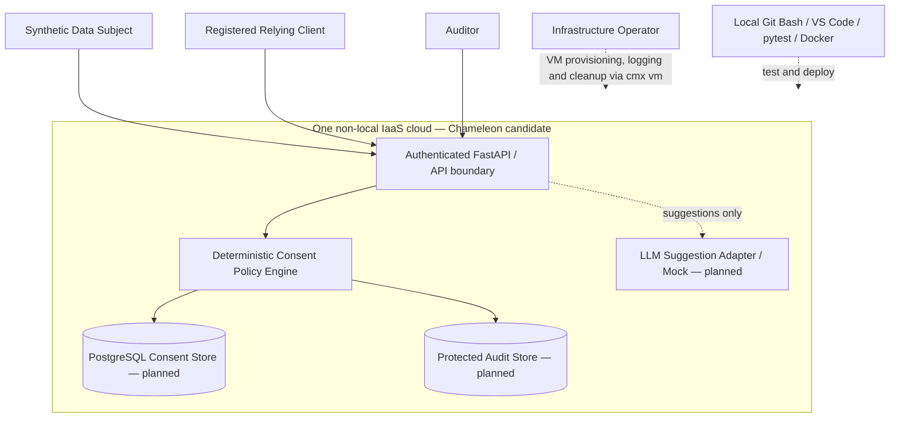

Cloud-Native Biometric Consent and Audit Platform
Student: Stephanie Wallace
GitHub: cloudmesh-ai-luc/AnieWall
Course: Cloud Computing, DevOps, and AI (CS 388/488)
Instructor: Professor Gregor von Laszewski
Original proposal: October 15, 2026
Updated: November 18, 2026
Status: Executable MVP 1 implemented locally; secure API, persistent storage, cloud deployment and LLM service are planned milestones
Scope clarification: Professor Gregor's November 15 guidance distinguishes the individual class project, which needs one non-local cloud, from the recurring cloudmesh-ai-vm assignments, which continue to cover the selected providers and require LLM-assisted development. The single-cloud requirement guides this proposal; it does not replace the separate weekly assignments.

1. Abstract
The Cloud-Native Biometric Consent and Audit Platform is a security-focused cloud application that translates a data subject's consent into a deterministic, enforceable decision for a specific simulated biometric-processing purpose. A relying client checks whether the relevant subject has active, purpose-matching consent before proceeding with a simulated operation. The subject may revoke consent; subsequent verification must return DENY. Grant, verification, denial and revocation events are recorded for audit.

This class project develops the earlier Biometric Contracts research into an executable Cloud Computing, DevOps, and AI demonstration. The first milestone is already implemented as a Python consent lifecycle library with a command-line demonstration, synthetic identifiers, and automated security tests. The next milestones add a trusted FastAPI authentication boundary, PostgreSQL persistence and durable audit records, Docker packaging, deployment on one non-local cloud (Chameleon is the current candidate, subject to successful access and provisioning), and an LLM-assisted consent-language suggestion service. Final authorization remains rule-based, not delegated to an LLM.

No real biometric images, templates or identifying biometric data are required or used for this class prototype. The project demonstrates technical control patterns; it does not claim regulatory certification or production readiness.

2. Problem and Research Motivation
Recording a consent statement is not the same as enforcing it. A biometric-reliant application must establish whether the requesting client is authorized, whether the subject approved the exact purpose, whether the consent is still active, and whether a later audit can explain the decision. Without those controls, stale permissions, unauthorized administrators, or applications requesting unrelated uses can defeat nominal consent.

Research-driven engineering question: How can we design biometric systems in which consent is not merely documented, but translated into enforceable technical controls that remain auditable throughout the data lifecycle?

The prior biometric research contributes the policy and lifecycle requirements. The course project concentrates on service implementation, cloud deployment, infrastructure management, DevOps automation, AI integration, and demonstrable security boundaries. Legal instruments and standards such as GDPR, BIPA, Ghana's Data Protection Act and ISO consent-record guidance inform the design discussion, but compliance cannot be established by this prototype alone.

3. Objectives and Measurable Success Criteria
   
a. Purpose-specific consent: A synthetic subject can grant consent for an approved purpose; an unrelated purpose returns DENY.
b. Effective revocation: A previously valid verification changes from ALLOW to DENY after subject-authorized revocation. Once persistence is introduced, this must remain true across service restart and concurrent workers.
c. Access control: The service distinguishes subject, relying client, administrator and auditor privileges; administrators cannot create or restore subject consent or exploit infrastructure privileges to view protected biometric content.
d. Auditability: Relevant decisions and lifecycle actions produce reviewable audit events; the later persistent implementation must resist ordinary administrator modification and define retention.
e. Runnable service: A small authenticated FastAPI application exposes the tested decision engine, with separate interfaces and integration tests.
f. Cloud deployment: Dockerized services operate on at least one non-local cloud, with reproducible provisioning, constrained network access, health checks, and cleanup evidence.
g. AI integration: An LLM (Jetstream-hosted if accessible, otherwise a compatible mock for tests) suggests structured consent purposes or explains text; validated, human-confirmed structured policy remains the only source of authorization.
h. DevOps evidence: Git feature branches, focused PRs, repeatable pytest runs, configuration hygiene, MkDocs and screenshots demonstrate progress.

4. Users, Roles, and Trust Boundaries
Actor	Permitted actions	Explicit limits
Data subject	Authenticate; grant/review/revoke their own purpose-bound consent	Cannot modify other subjects' records
Relying client	Authenticate; verify only registered purposes for an authorized subject context	Cannot grant, revoke, or turn an LLM suggestion into consent
Administrator / cloud operator	Manage deployment, service health, and restricted policy configuration	Infrastructure role must not imply access to biometric content or permission to override subject consent
Auditor	Read approved audit metadata	Cannot create, revoke, or alter consent; cannot rewrite audit evidence

Current limitation: MVP 1 uses caller-created Principal objects for local testing. These are not authenticated identities. A future trusted FastAPI boundary must authenticate users and clients, derive principals server-side, enforce subject/client relationships, and reject caller-supplied role assertions. The current library must not be exposed directly as a public HTTP service.

5. Consent Lifecycle and Demonstration
Synthetic subject authenticates (future API)
    -> grants purpose-bound consent
    -> relying client requests verification
       -> approved client + same subject + active exact purpose: ALLOW
       -> missing / wrong-purpose / revoked / unauthorized: DENY
    -> subject revokes consent
    -> repeat verification: DENY
    -> auditor reviews lifecycle events
The deterministic policy engine—not free-form AI text—computes authorization. The MVP demonstration uses only synthetic identifiers:
Approved purpose before revocation: ALLOW (active-purpose-matched)
Different purpose: DENY (no-consent)
Approved purpose after revocation: DENY (revoked)
Recorded audit events: 6

6. Revised Cloud Architecture
6.1 Deployment decision
Minimum project deployment: One non-local cloud. Chameleon is the preferred candidate because it supports VM-based experimentation, and Professor Gregor highlighted its Heat orchestration capabilities. Chameleon access, resources, Heat availability and actual deployment are not yet verified for this application. If unavailable, select another supported non-local cloud and document the reason; avoid committing to an untested second cloud.
- Local Windows / Git Bash / VS Code: Development, pytest, Docker builds and demonstrations; Multipass is optional for local VM experiments.
- Non-local cloud candidate — Chameleon: One or more VMs running Dockerized consent API, backend datastore and protected audit functionality, with network segmentation and secured administration.
- Jetstream LLM: Development and optional remote inference assistance, subject to endpoint access; it is not a requirement to host a second application cloud tier.
- cmx vm: Infrastructure provisioning, inspection and cleanup where the chosen provider integration supports it. It is not the consent decision engine.
- Kubernetes / multiple application clouds / Heat templates: Optional extensions after a stable single-cloud system; not prerequisites for MVP acceptance. Heat is evaluated, not presumed operational.
6.2 Logical architecture

Security principle: Network access, authentication, application authorization, data storage, and audit access are separate controls. A cloud-provider security group cannot substitute for purpose checks or authenticated users.

7. Application Components and Repository Layout
AnieWall/
├── assignments/STATUS.md       # weekly activity and evidence links
├── project/project.md          # this proposal and truthful current status
├── docs/                       # security, lifecycle, deployment and MkDocs
├── src/biometric_consent/
│   ├── consent.py              # MVP 1 deterministic in-memory engine
│   └── demo.py                 # MVP 1 synthetic CLI walkthrough
├── tests/test_consent.py       # MVP 1 lifecycle and security tests
├── Makefile                    # repeatable install/test/demo/deploy targets
├── mkdocs.yml
└── pyproject.toml
Planned additions include authenticated FastAPI endpoints and schemas, persistence/repository modules, migrations, API tests, Docker/Compose configuration, cloud deployment scripts, and an isolated LLM adapter/mock. Every file will be documented as implemented or planned, rather than assumed to exist.

8. Data Architecture, Revocation and Retention
MVP 1 implemented: In-memory consent records with subject identifier, consent ID, exact purpose, state, timestamps, and sequential in-process audit events. No real biometric content is stored. All state and logs are lost when the Python process exits.

Planned PostgreSQL design: Normalize subjects, registered clients, consent grants, revocations, purpose policy, and audit metadata. Use constraints and transactions so revocation cannot race with verification; design read consistency and cache invalidation across replicas. Provide schema migrations, restricted database roles, backup and restore tests, and explicit retention/deletion policies. Keep any synthetic biometric references separate from consent metadata.

Revocation must block future use without pretending that audit evidence can always be deleted immediately: define privacy-preserving retention and restricted access for records necessary to establish that revocation occurred.

9. LLM Integration and Model Safety
The AI component may assist with:
- suggesting a controlled purpose identifier from human-readable consent text;
- detecting ambiguity or missing limits;
- proposing documentation, tests or code improvements for human review;
- explaining a denial without disclosing protected consent metadata.
The model never grants consent or returns the final authorization decision. A human must confirm any proposed purpose/consent mapping; the deterministic engine then validates approved identifiers, subject action, and current state.

Use the Jetstream LLM integration demonstrated in Cline and Python where available. The cloudmesh-ai-llm-mock repository is a useful reference for an independently testable mock service. Tests must not depend on a live API key, endpoint, or cloud model. Record model limitations, incorrect suggestions, review decisions and examples using synthetic text only.

10. Security Architecture and Cloud Shared Responsibility
Drawing on Professor Abuhamad's cloud-security lecture—especially security groups (slide 61) and the Cloud Responsibility Matrix (slide 63)—the external infrastructure provider is responsible for its physical facilities and underlying hardware, while the application developer remains responsible for the guest OS, deployed containers, authentication, access controls, secure storage, application code, and appropriately configured network policies.
Threat / misuse	Control and verification target
Administrator grants consent without subject	Denied by application policy; explicit negative tests; no administrator grant endpoint
Administrator reads or revokes another subject	Separation of duties and authorization checks; audit access scoped by role
Fake subject or client identity	Trusted authentication, server-derived principal, signed tokens/sessions, subject-client relationship checking
Wrong purpose / LLM hallucination	Exact controlled identifiers and deterministic DENY; LLM cannot authorize
Revoked consent still used	Current-state check and durable transactional revocation; tests after restart and across workers
Audit tampering	Restricted writer, protected append-only records, integrity verification, monitored retention
Credential leakage	Secrets outside GitHub and source control; protected ~/.config/... or cloud-managed secrets; key rotation
Traffic interception / public database	TLS, narrowly scoped security groups/firewall rules, private DB exposure only
Data loss	Backups, restore testing, migrations, recovery procedure and documented deletion-versus-retention rules
Dependency or supply-chain compromise	Isolated virtual environments, pinned/reviewed dependencies, CI tests, dependency and secret scans

Never commit: .env files, cloud credentials, API tokens, SSH private keys, biometric images or real subject data. Infrastructure credentials and application secrets must use protected configuration, not hard-coded project values. Current MVP 1 security rules do not make the library production secure; authenticated API boundaries and durable storage remain to be built.

11. DevOps and cmx vm Integration
The project uses reproducible Git Bash, Python 3.11, an isolated virtual environment, version-controlled Markdown documentation, pytest, small feature branches and PR review. The local work begins with python -m pip install -e '.[dev]', python -m pytest -q, and python -m biometric_consent.demo.

After containerization, the deployment workflow will include build, configuration validation, health checks, API smoke tests, network checks, secure provisioning/teardown and screenshots. GitHub Actions CI is a planned extension to run tests and safe static checks on each PR; deployment secrets will not be available to untrusted PR code.

Separate course track: The weekly cloudmesh-ai-vm assignments continue multi-provider development/testing on their prescribed branch (dev3), with LLM-assisted review. These are reported independently in assignments/STATUS.md. They are not evidence that the biometric application has already been deployed on all three clouds.

12. Development Milestones and Status
Milestone	Work and deliverable	Status at November 18, 2026
MVP 1 — Deterministic consent engine	Purpose-limited grants, verification, revoke, audit events, negative tests and CLI demo	Completed locally: 21 consent tests passed; 22 total repository tests passed; expected ALLOW/DENY and six-event demo observed. Published on feature branch; PR #4 is open, not merged
MVP 2 — Authenticated FastAPI	Server-side identity, client/subject binding, separate endpoints, strict schemas, API tests	Not started
MVP 3 — PostgreSQL + durable audit	Schema/migrations, transactional revocation, audit protection, backup and recovery	Not started
MVP 4 — Docker + non-local deployment	Container(s), network/security groups, one non-local cloud, cmx vm evidence, cleanup	Not started; Chameleon candidate
MVP 5 — LLM + mock adapter	Jetstream/model suggestion interface, deterministic mock tests, human review, no AI authorization	Planned; Jetstream inference has been demonstrated in a separate course activity, not yet integrated into this consent app
MVP 6 — Final evidence and presentation	Architecture diagram, GitHub PRs, runbook, MkDocs, terminal screenshots, failure cases and limitations	Planned

The earlier broad Azure + Jetstream protected tier + Kubernetes architecture is retained only as a possible future research extension, not as a completed or required course-project deployment.

13. Demonstration and Acceptance Plan
The final live demonstration should show: (1) a synthetic subject grants an exact purpose; (2) a registered client receives ALLOW; (3) an unrelated or unauthorized purpose receives DENY; (4) a subject revokes and the client receives DENY; (5) an infrastructure administrator cannot bypass consent; (6) an authorized auditor views permitted events; (7) persisted data and revocation survive restart after MVP 3; (8) the Dockerized service runs on a non-local cloud after MVP 4; and (9) a model suggestion is reviewed rather than directly executed after MVP 5.

Each result should have a reproducible command, test assertion, terminal screenshot or documentation link. Mark pending demonstrations honestly until observed on the actual deployment.

14. Risks, Constraints, and Open Questions
- Chameleon availability: Verify account access, project/lease validity, provider image, VM limits and whether Heat is usable; choose a supported fallback if not.
- Cloud cost and resources: Prefer a modest deployment that can be torn down reliably; do not require Kubernetes for an otherwise complete single-cloud demo.
- Authentication: Do not expose MVP 1 to untrusted HTTP requests until identities are verified and role/subject relationships are enforced.
- Revocation consistency: Define behavior under concurrency, restarts and cached decisions before claiming durable enforcement.
- Audit integrity: Design protected append-only retention and tamper-evidence, distinguishing it from ordinary log statements.
- Admin abuse: Demonstrate controls at both application and infrastructure privilege boundaries.
- AI errors: Validate all outputs; separate advisory language assistance from deterministic authorization.
- Legal/ethical scope: Synthetic-only demonstration; GDPR/BIPA/Ghana DPA/ISO references guide design, not proof of compliance.

15. Final Project Deliverables
- Updated project/project.md and architectural diagram reflecting actual cloud scope.
- Executable consent service, relying-client demonstration and test suite.
- Authenticated API and PostgreSQL persistence with audit safeguards (when implemented).
- Docker images/Compose configuration and a single non-local cloud deployment runbook and validation evidence.
- LLM integration with a mock testing path and clear human-approval boundary.
- README.md, MkDocs technical documentation, security responsibilities and threat model.
- Development history through Git feature branches/PRs, reproducible tests, terminal screenshots and assignments/STATUS.md updates (no video needed for this project evidence package).
- Final presentation with architecture, implementation results, limitations, and comparison of planned versus completed milestones.

16. Relationship to Classroom Guidance and Reference Projects
- Professor Gregor's November 15 Piazza clarification: One non-local cloud for the individual project; three selected providers remain in the weekly VM assignment track.
- Professor Gregor's midterm notes: Prefer a demonstrable working system, discuss administrator misuse, explain how the LLM helped and validate model outputs; Chameleon Heat is an option to investigate.
- Professor Abuhamad's Week 10 cloud security: Shared-responsibility matrix and network security groups inform boundaries; cloud infrastructure controls do not replace application permissions.
- Kbass project: Reference for modular organization, incremental working deliverables and clear implementation status.
- Sam Stewart project: Reference for polished architecture, explicit objectives, acceptance criteria, security and deployment evidence. Our source code and design remain independent.
- Cloudmesh mock service: Reference for local/mock behavior and deterministic offline testing of LLM-integrated components.

17. Repository Evidence and Supporting Documents
- MVP 1 pull request #4
- [MVP 1 executable lifecycle documentation](../docs/mvp1-consent-lifecycle.md)
- [Cloud security responsibilities and threat model](../docs/cloud-security-shared-responsibility.md)
- [November 18 professor feedback and milestone decision record](2026-11-18-scope-and-feedback.md)
- [Course progress log](../assignments/STATUS.md)
- Cloud Computing assignment references

18. Current Project Status and Next Action
As of November 18, 2026, the deterministic consent engine has passed the targeted 21 tests and the full 22-test repository suite in the student's local environment; its synthetic demonstration produced the expected permission and revocation decisions. The changes are in PR #4, pending merge. No authenticated API, PostgreSQL-backed consent store, durable tamper-resistant audit store, Dockerized cloud deployment or integrated consent-language LLM service should be represented as complete.

Next action: Review this revised proposal as part of the same feature branch, verify the documentation accurately distinguishes completed and planned work, then review and merge PR #4 when ready. Begin MVP 2 on its own focused branch after MVP 1 has been integrated.
