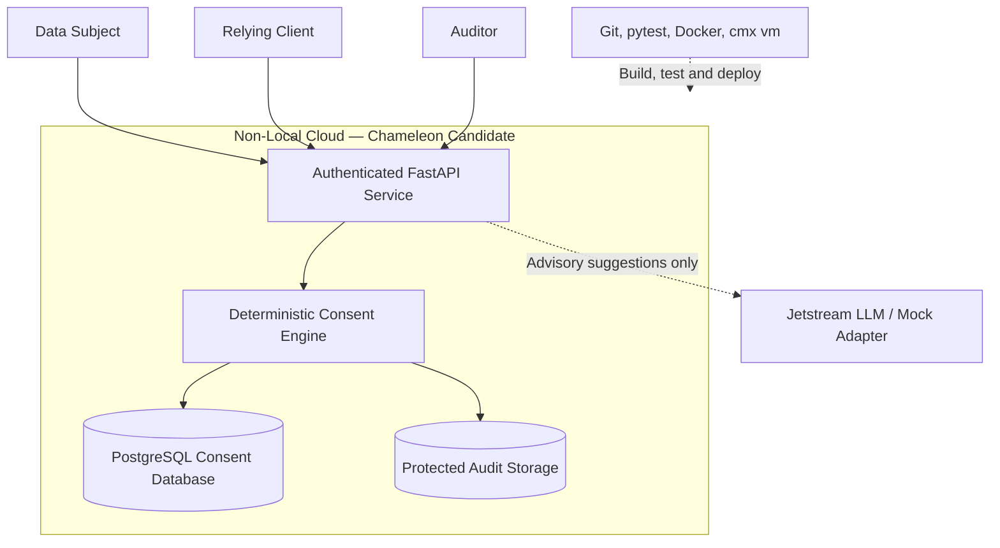

# Cloud-Native Biometric Consent and Audit Platform

**A Secure, Auditable, Cloud-Based Consent Management System**

| Project Information | Details |
|---|---|
| **Student** | Stephanie Wallace |
| **Course** | CS 388/488 — Cloud Computing, DevOps, and AI |
| **Instructor** | Professor Gregor von Laszewski |
| **GitHub Repository** | [cloudmesh-ai-luc/AnieWall](https://github.com/cloudmesh-ai-luc/AnieWall) |
| **Original Proposal** | October 15, 2026 |
| **Last Revised** | November 18, 2026 |
| **Development Status** | MVP 1 implemented and tested; subsequent milestones in development |
| **Current Pull Request** | [PR #4 — Biometric Consent Lifecycle Engine](https://github.com/cloudmesh-ai-luc/AnieWall/pull/4) |

---

## Project Overview

The **Cloud-Native Biometric Consent and Audit Platform** is a security-focused application designed to demonstrate how biometric consent can be transformed from a legal or administrative record into an enforceable technical control.

The platform will enable individuals to grant, verify, review, and revoke consent for specific biometric-processing purposes while generating auditable records of consent-related activities.

It combines:

- **Cloud Computing:** Deployment of containerized services on a non-local cloud infrastructure.
- **DevOps:** Reproducible installation, testing, infrastructure management, version control, and deployment automation.
- **Cybersecurity:** Authentication, authorization, least-privilege access, encryption, audit integrity, and privacy safeguards.
- **Artificial Intelligence:** LLM-assisted interpretation of consent-related language without delegating authorization decisions to AI.
- **Biometric Privacy Research:** Consent lifecycle management informed by privacy law, technical standards, and the Biometric Contracts research.

**Current implementation:** The first executable consent-management engine has been developed and validated locally using synthetic data. Its automated tests and demonstration confirm purpose-specific authorization, revocation, and in-memory audit behavior.

**Deployment clarification:** Professor Gregor's November 15 guidance requires the individual class project to run on at least one non-local cloud. The separate weekly `cloudmesh-ai-vm` assignments continue to require work across the prescribed providers.

---

## Table of Contents

1. [Abstract](#1-abstract)
2. [Problem and Research Motivation](#2-problem-and-research-motivation)
3. [Project Objectives](#3-project-objectives)
4. [System Users and Roles](#4-system-users-and-roles)
5. [Consent Lifecycle Management](#5-consent-lifecycle-management)
6. [Cloud Architecture](#6-cloud-architecture)
7. [Application Components and Repository Structure](#7-application-components-and-repository-structure)
8. [Data Architecture and Consent Retention](#8-data-architecture-and-consent-retention)
9. [LLM Integration and Model Safety](#9-llm-integration-and-model-safety)
10. [Security Architecture and Threat Model](#10-security-architecture-and-threat-model)
11. [Cloud Shared Responsibility and DevOps](#11-cloud-shared-responsibility-and-devops)
12. [Implementation Roadmap](#12-implementation-roadmap)
13. [Testing and Evaluation](#13-testing-and-evaluation)
14. [Risks and Constraints](#14-risks-and-constraints)
15. [Expected Deliverables](#15-expected-deliverables)
16. [Relationship to Classroom Guidance](#16-relationship-to-classroom-guidance)
17. [Repository Evidence and Documentation](#17-repository-evidence-and-documentation)
18. [Current Project Status and Next Steps](#18-current-project-status-and-next-steps)

---

## 1. Abstract

Biometric systems increasingly rely on sensitive physiological or behavioral characteristics to identify and authenticate individuals. Although consent is often obtained before collecting biometric information, many systems lack reliable mechanisms to enforce the conditions of that consent throughout the data lifecycle.

This project develops a **Cloud-Native Biometric Consent and Audit Platform** that demonstrates how consent can be expressed, evaluated, revoked, and audited through software-enforced controls.

The proposed application combines a deterministic consent-management engine with authenticated interfaces, persistent storage, protected audit records, containerized deployment, and LLM-assisted interpretation of consent language.

The platform will initially operate using synthetic subjects and simulated biometric-processing requests to avoid exposing real biometric information.

The ultimate objective is to demonstrate that biometric consent can function as an **enforceable and auditable authorization requirement**, rather than simply a signed document or database entry.

---

## 2. Problem and Research Motivation

### 2.1 The Problem

Traditional consent management frequently emphasizes obtaining and recording an individual's consent.

However, recording consent does not necessarily guarantee that a system will respect its limitations.

Important questions include:

- How does a system establish whether consent remains valid?
- How can processing be restricted to the precise purpose authorized?
- What happens when an individual withdraws consent?
- How can unauthorized applications or administrators be prevented from bypassing consent restrictions?
- How can consent decisions be reconstructed during an audit?
- How should retained audit evidence be reconciled with privacy and deletion requirements?

These questions are particularly important in biometric applications because compromised biometric characteristics cannot readily be replaced like passwords.

### 2.2 Research Question

> How can we design biometric systems in which consent is not merely documented, but translated into enforceable technical controls that remain auditable throughout the data lifecycle?

### 2.3 Research Foundation

This project builds upon the ongoing **Biometric Contracts** research, which examines consent governance, technical enforceability, privacy safeguards, and the relationship between legal consent requirements and biometric-system implementation.

Relevant regulatory and technical references include:

- General Data Protection Regulation (GDPR)
- Illinois Biometric Information Privacy Act (BIPA)
- Ghana Data Protection Act, 2012 (Act 843)
- ISO/IEC 27560 — Consent record information structure
- ISO/IEC 24745 — Biometric information protection
- ISO/IEC 23894 — Artificial intelligence risk management

These references inform the system design. The educational prototype does not claim regulatory certification or complete legal compliance.

---

## 3. Project Objectives

The project has eight primary objectives.

| Objective | Description | Success Criterion |
|---|---|---|
| **Consent creation** | Allow subjects to authorize specific processing purposes | Valid purpose-specific consent is recorded |
| **Consent verification** | Evaluate authorization before simulated processing | Deterministic `ALLOW` or `DENY` |
| **Consent revocation** | Allow subjects to withdraw authorization | Subsequent requests are denied |
| **Access control** | Separate subject, client, auditor, and administrator permissions | Unauthorized actions are rejected |
| **Auditability** | Record relevant authorization and lifecycle events | Reviewable audit history |
| **Cloud deployment** | Deploy the application on a non-local cloud | Running service with verified access and health checks |
| **LLM integration** | Assist with interpreting consent language | Human-reviewed structured suggestions |
| **DevOps automation** | Support reliable development and maintenance | Repeatable installation, tests, deployment, and documentation |

The first four objectives and basic in-memory auditability are implemented in MVP 1.

The remaining capabilities will be developed incrementally.

---

## 4. System Users and Roles

The platform distinguishes four principal actors.

| Role | Responsibilities | Restrictions |
|---|---|---|
| **Data Subject** | Grant, inspect, and revoke their own consent | Cannot modify another subject's consent |
| **Relying Client** | Verify whether a registered processing purpose is authorized | Cannot create or revoke consent |
| **Administrator** | Maintain application services and infrastructure | Cannot override the subject's consent decisions |
| **Auditor** | Review permitted consent and authorization events | Cannot modify consent or rewrite audit records |

### 4.1 Separation of Duties

The architecture separates infrastructure administration from biometric-consent authorization.

For example, permission to restart a cloud virtual machine must not automatically grant permission to approve biometric processing.

This distinction responds directly to Professor Gregor's concern about how administrators might exploit sensitive biometric data.

### 4.2 Current Implementation Limitation

MVP 1 uses programmatically created `Principal` objects to represent subjects, clients, and administrators.

These objects are not yet connected to a real authentication mechanism.

Therefore, **MVP 1 must not be exposed as a publicly accessible authorization API**.

MVP 2 will introduce authenticated identities, trusted server-side role assignment, and subject-to-client authorization checks.

---

## 5. Consent Lifecycle Management

Consent lifecycle management is the core functionality of the platform.

### 5.1 Lifecycle Stages

The proposed lifecycle consists of six stages:

1. **Grant:** A subject explicitly authorizes a registered purpose.
2. **Record:** The platform records the consent and its relevant metadata.
3. **Verify:** A relying client requests authorization for a processing operation.
4. **Enforce:** The system permits or denies the operation based on deterministic policy rules.
5. **Revoke:** The subject withdraws an existing authorization.
6. **Audit:** Authorized auditors inspect permitted records of lifecycle activities.

### 5.2 Consent Enforcement Workflow

```text
Data Subject
    |
    v
Grant Purpose-Specific Consent
    |
    v
Consent Record Created
    |
    v
Relying Client Requests Verification
    |
    v
Consent Policy Engine
    |
    +-- Valid Subject and Authorized Purpose
    |       |
    |       v
    |      ALLOW
    |
    +-- Missing, Invalid, or Revoked Consent
            |
            v
           DENY

Relevant actions generate audit events.
```

The policy engine uses structured, deterministic authorization rules rather than relying on free-form LLM judgments.

### 5.3 MVP 1 Demonstration Results

The first executable demonstration was completed on November 18, 2026.

```text
Cloud-Native Biometric Consent and Audit — MVP 1

All identifiers below are synthetic;
no biometric data is stored.

Approved purpose before revocation:
ALLOW (active-purpose-matched)

Different purpose:
DENY (no-consent)

Approved purpose after revocation:
DENY (revoked)

Recorded audit events: 6
```

This demonstrates that authorization can depend on the current consent state and the exact intended purpose.

---

## 6. Cloud Architecture

### 6.1 Deployment Strategy

The initial class project will prioritize **one non-local cloud deployment**.

Chameleon is the preferred candidate, subject to available resources, access permissions, and successful infrastructure validation.

| Infrastructure | Proposed Use |
|---|---|
| **Local Windows environment** | Development, Git Bash, VS Code, Python tests, and debugging |
| **Chameleon Cloud** | Preferred deployment environment for the containerized application |
| **Docker** | Packaging the application and its supporting services |
| **PostgreSQL** | Persistent consent and audit-related data |
| **Jetstream LLM** | LLM-assisted development and optional consent-language interpretation |
| **Cloudmesh `cmx vm`** | Infrastructure provisioning, inspection, and cleanup where supported |
| **Kubernetes / Heat** | Optional extensions after a successful initial deployment |

This deployment strategy reflects Professor Gregor's instruction to simplify the class project while preserving the separate multi-provider assignments.

### 6.2 Proposed System Architecture

The following diagram represents the **target architecture**, not a claim that every component is already operational.



### 6.3 Architectural Principles

The architecture will follow these principles:

- Separate application authentication from infrastructure permissions.
- Enforce consent decisions through deterministic policy rules.
- Restrict access to persistent consent records.
- Protect audit events from unauthorized modification.
- Use encryption for sensitive data in transit and at rest.
- Keep external LLM services outside the final authorization decision.
- Use reproducible deployment and testing workflows.

---

## 7. Application Components and Repository Structure

### 7.1 Main Application Components

The application will be organized into independently testable components.

| Component | Function | Development Stage |
|---|---|---|
| Consent Engine | Grant, verify, and revoke consent | MVP 1 |
| Audit Engine | Record consent and authorization events | Basic version in MVP 1 |
| Authentication API | Verify subjects, clients, and auditors | MVP 2 |
| Persistent Storage | Store consent and supporting metadata | MVP 3 |
| Protected Audit Storage | Maintain durable, restricted audit records | MVP 3 |
| Containerized Deployment | Package and deploy services | MVP 4 |
| LLM Adapter | Interpret or suggest consent-related purpose mappings | MVP 5 |

### 7.2 Repository Organization

The project follows the structure recommended in the Cloud Computing and DevOps course.

```text
AnieWall/
|
|-- assignments/
|   |-- STATUS.md
|
|-- project/
|   |-- project.md
|   |-- 2026-11-18-scope-and-feedback.md
|   |--
